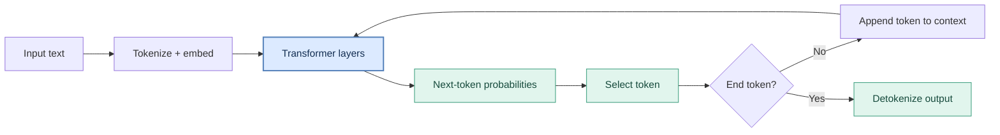

# Autoregressive LLM — Token-by-Token Generation

A simplified view of **inference in a decoder-only language model**. It predicts a probability distribution over the *next token*, selects one token, appends it to the sequence, and repeats.

## How to read it

1. **Tokenize + embed:** Convert the input text into token IDs and vector representations (with positional information).
2. **Transformer layers:** Process the context to produce contextual representations.
3. **Next-token probabilities:** A language-model output head maps the latest representation into vocabulary logits; softmax yields a distribution over candidate next tokens.
4. **Select token:** Choose a token (e.g., greedy selection or sampling).
5. **Repeat:** Feed the newly selected token back in, until an end-of-sequence token or other stopping condition. Finally convert generated tokens to readable text.

**Presentation takeaway:** The transformer is run repeatedly because each new output token depends on the preceding tokens.

> Simplification: In practical inference, a key/value cache usually avoids recomputing all earlier tokens on every iteration. Also, token decoding can happen incrementally rather than only at the end.

## Comparison point

An LLM's probabilities are **over vocabulary tokens**, *not inherently over the possible answers to a business decision*. Asking an LLM for `Approve` or `Reject` still ordinarily involves text-token prediction (even when constrained to a schema).
